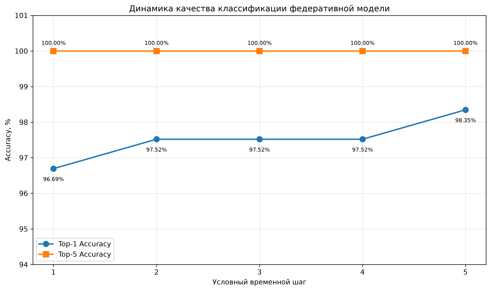
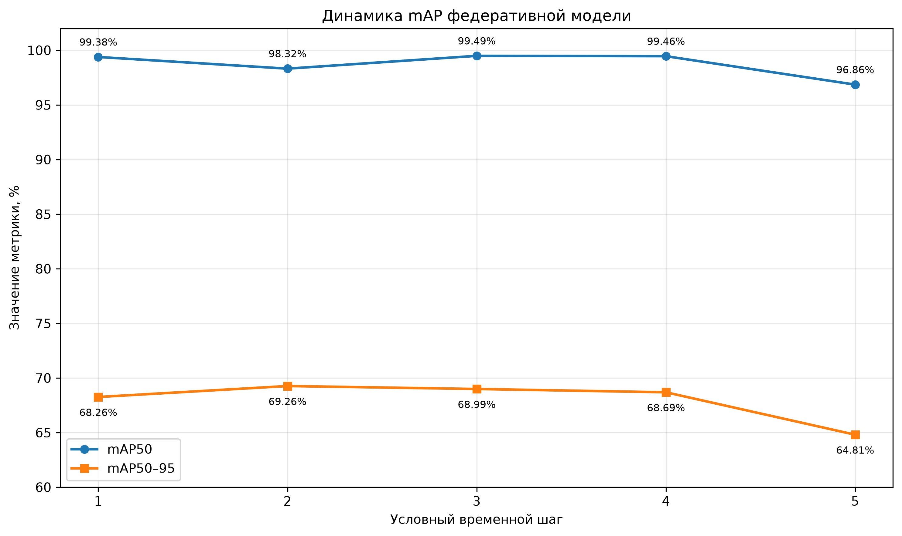
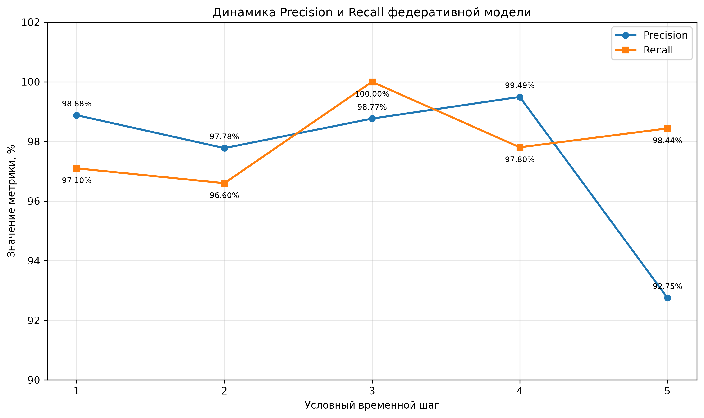
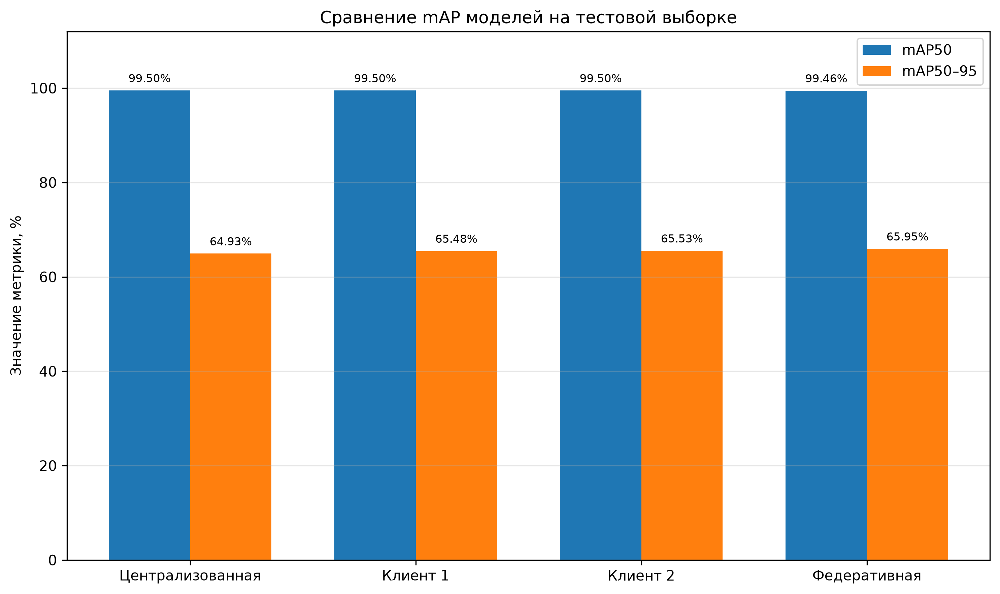
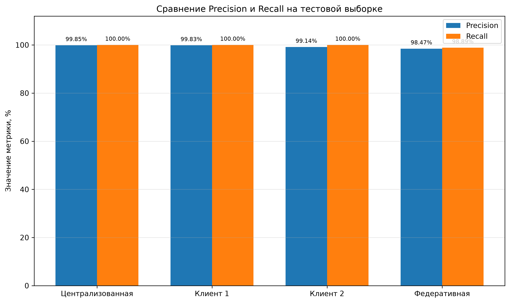
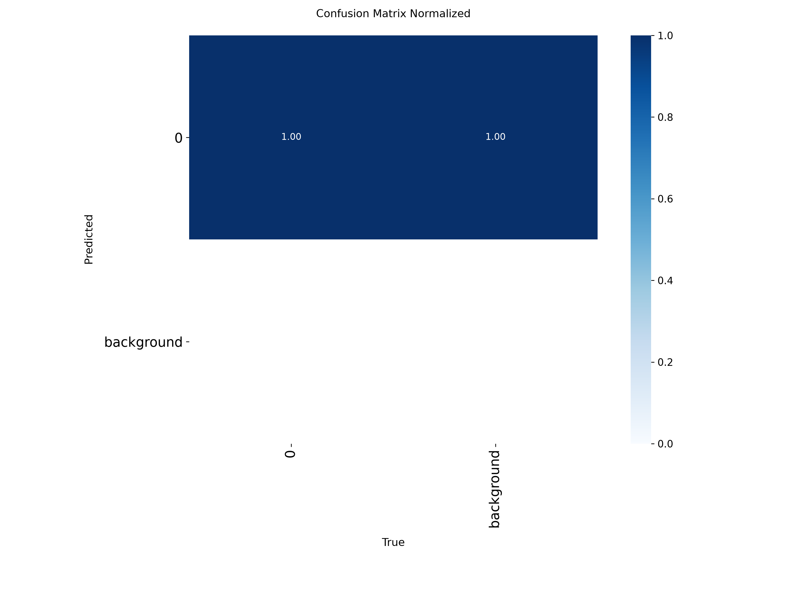

# Экспериментальное исследование централизованного, локального и федеративного обучения моделей обнаружения огнетушителей

## 1. Цель исследования

Цель экспериментального исследования - сравнить качество обнаружения огнетушителей при использовании трёх подходов к обучению моделей машинного обучения:

1. Централизованное обучение, при котором все обучающие данные доступны в одном месте.
2. Локальное обучение, при котором каждый клиент независимо обучает собственную модель на принадлежащей ему части данных.
3. Федеративное обучение, при котором несколько клиентов совместно обучают общую модель посредством обмена параметрами моделей без передачи исходных данных координатору.

В качестве базовой архитектуры для решения задачи обнаружения объектов использовалась YOLO11n. Дополнительно в федеративном эксперименте применялась классификационная модель YOLO11n-cls, предназначенная для определения наличия или отсутствия огнетушителя на изображении.

## 2. Подготовка набора данных

### 2.1. Характеристика набора данных

Для эксперимента использовался синтетический набор изображений, содержащий 10 000 изображений. На изображениях присутствуют огнетушители в различных условиях съёмки и расположения.

Набор был разделён на три части:

| Выборка | Количество изображений |
|---|---:|
| Обучающая | 9 758 |
| Валидационная | 121 |
| Тестовая | 121 |
| **Всего** | **10 000** |

Обучающая выборка использовалась для настройки параметров моделей. Валидационная выборка применялась для оценки промежуточных результатов и анализа изменения качества моделей. Тестовая выборка была отложена до заключительного этапа эксперимента и использовалась для итогового сравнения подходов.

Тестовая выборка содержала 90 экземпляров огнетушителей. Остальные изображения не содержали размеченных объектов.

### 2.2. Формирование разметки

Для подготовки обучающей выборки использовались три источника разметки:

| Тип разметки | Количество изображений |
|---|---:|
| Ручная разметка | 966 |
| Псевдоразметка по согласованным предсказаниям моделей | 5 055 |
| Псевдоотрицательные изображения | 3 737 |
| **Всего** | **9 758** |

Псевдоразметка формировалась с использованием предсказаний двух исходных моделей. В случае согласованного обнаружения объекта использовалась соответствующая разметка.

Псевдоотрицательными считались изображения, на которых обе исходные модели не обнаружили огнетушитель. При этом отсутствие предсказания не гарантирует фактического отсутствия объекта, поэтому данный тип разметки рассматривается как потенциально менее надёжный по сравнению с ручной.

Дополнительно 908 спорных изображений были проверены в CVAT.
Валидационная и тестовая выборки имели ручную разметку. Это позволило оценивать качество моделей на данных, не зависящих от псевдоразметки обучающей выборки.

### 2.3. Разделение данных между клиентами

Для локального и федеративного обучения обучающая выборка была разделена между двумя клиентами.

Использовалось IID-разделение: данные случайным образом распределялись между клиентами с сохранением соотношения положительных и отрицательных изображений. Для воспроизводимости применялось фиксированное значение `random_state = 42`.

| Показатель | Клиент 1 | Клиент 2 |
|---|---:|---:|
| Всего изображений | 4 879 | 4 879 |
| Положительные изображения | 2 890 | 2 890 |
| Отрицательные изображения | 1 989 | 1 989 |
| Экземпляры огнетушителей в разметке | 2 910 | 2 902 |

Таким образом, каждый клиент получил примерно половину обучающей выборки.

В обоих клиентских наборах сохранялась структура YOLO: изображения размещались в каталоге `images/train`, а соответствующие файлы разметки — в `labels/train`. Для изображений без объектов использовались пустые файлы разметки.

Валидационная и тестовая выборки оставались общими. Это обеспечивало сопоставимость результатов моделей, обученных на разных клиентских данных.

## 3. Экспериментальная постановка федеративного обучения

### 3.1. Общая схема

В качестве основы федеративного эксперимента использовалась модель совместного обучения нескольких агентов, при которой исходные наблюдения остаются локально у соответствующих клиентов.

Мы использовали два клиента и один координатор.

Каждый клиент обладал собственной локальной историей наблюдений. Обучение выполнялось на скользящем окне последних наблюдений, а координатор отвечал за инициализацию глобальных параметров, получение локальных обновлений и их агрегацию.

На каждом раунде клиенты получают актуальные глобальные параметры, выполняют локальное обучение, после чего координатор агрегирует полученные обновления.

### 3.2. Представление свойств окружающей среды

Для каждого свойства окружающей среды используется отдельная независимая модель.

Мы рассматривли два свойства:

| Свойство | Назначение модели | Тип результата |
|---|---|---|
| Наличие объекта | Определение присутствия или отсутствия огнетушителя | Бинарная классификация |
| Положение объекта | Обнаружение огнетушителя и определение его положения | Координаты ограничивающих рамок |

Для свойства наличия объекта использовалась классификационная модель YOLO11n-cls с двумя классами:

- `absent` — объект отсутствует;
- `present` — объект присутствует.

Для свойства положения объекта использовалась модель обнаружения YOLO11n с одним классом `fire_extinguisher`.

Результат обнаружения включает координаты ограничивающей рамки каждого найденного объекта. При наличии нескольких огнетушителей на изображении модель может возвращать несколько рамок.

Уверенность предсказания и время наблюдения не рассматривались как отдельные обучаемые свойства. Уверенность формируется моделью при получении предсказания, а временная метка соответствует индексу текущего наблюдения.

### 3.3. Скользящее окно наблюдений

Для имитации последовательного поступления наблюдений использовалось скользящее окно фиксированного размера.

Размер окна составлял:

$$
\Delta = 2000
$$

Шаг перемещения окна:

$$
s = 720
$$

Таким образом, соседние окна перекрывались на 1280 изображений, что соответствует 64% размера окна.

Для формирования пяти последовательных временных шагов использовались следующие начальные позиции:

| Временной шаг | Начальная позиция окна | Размер окна |
|---|---:|---:|
| 1 | 0 | 2 000 |
| 2 | 720 | 2 000 |
| 3 | 1 440 | 2 000 |
| 4 | 2 160 | 2 000 |
| 5 | 2 879 | 2 000 |

Последнее окно было сдвинуто к допустимой конечной позиции, чтобы сохранить фиксированный размер выборки.

### 3.4. Алгоритм федеративного обучения

На каждом временном шаге выполнялось пять раундов агрегации FedAvg.

Обозначим:
- $i$ - номер клиента;
- $l$ - номер свойства окружающей среды;
- $r$ - номер раунда федеративного обучения;
- $\theta_l^r$ - глобальные параметры модели для свойства $l$ на раунде $r$;
- $\theta_{i,l}^{r+1}$ - параметры локальной модели клиента $i$ после обучения;
- $m_{i,l}$ - количество обучающих изображений клиента $i$;
- $m_l$ - суммарное количество изображений всех клиентов.

На каждом раунде координатор выполняет следующие действия:

1. Передаёт текущие глобальные параметры соответствующим клиентам.
2. Каждый клиент инициализирует локальную модель полученными параметрами.
3. Клиент выполняет локальное обучение на собственном скользящем окне наблюдений.
4. После завершения локального обучения клиент передаёт координатору параметры модели.
5. Координатор выполняет взвешенное усреднение полученных параметров.
6. Полученные параметры становятся новой глобальной моделью и используются в следующем раунде.

Формула агрегации FedAvg:

$$
\theta_l^{r+1}
=
\sum_{i=1}^{N}
\frac{m_{i,l}}{m_l}
\theta_{i,l}^{r+1}
$$

где:

$$
m_l = \sum_{i=1}^{N} m_{i,l}
$$

В данном эксперименте оба клиента использовали окна одинакового размера - 2000 изображений. Поэтому вес каждого клиента составлял:

$$
\frac{m_{i,l}}{m_l}
=
\frac{2000}{4000}
=
0{,}5
$$

Следовательно, при агрегации параметры двух клиентов имели одинаковый вес.

Для числовых параметров модели выполнялось взвешенное усреднение. Для целочисленных и логических буферов, которые не являются обычными обучаемыми вещественными параметрами, использовалось сохранение значения соответствующего буфера первого клиента.

Важно, что координатор получал обновлённые параметры моделей, а не исходные изображения или файлы разметки. Исходные обучающие данные оставались у клиентов.

После завершения пяти раундов агрегации на текущем временном шаге полученная глобальная модель сохранялась и использовалась как основа для следующего шага.

### 3.5. Формирование базы знаний

После завершения обучения каждый клиент может применить полученную глобальную модель к текущему наблюдению.

Результат интерпретируется отдельно для каждого свойства окружающей среды. В общем виде знание представляется кортежем:

$$
k_{i,l}(t_j)
=
\left(
p_l,\,
v_{i,l}(t_j),\,
c_{i,l}(t_j),\,
\tau_{i,l}(t_j)
\right)
$$

где:

- $p_l$ - рассматриваемое свойство окружающей среды;
- $v_{i,l}(t_j)$ - значение свойства, полученное моделью;
- $c_{i,l}(t_j)$ - уверенность модели в предсказании;
- $\tau_{i,l}(t_j)$ - временная метка наблюдения.

Для каждого клиента база знаний формируется как множество полученных знаний по всем рассматриваемым свойствам:

$$
K_i(t_j)
=
\left\{
k_{i,l}(t_j)
\mid
p_l \in P
\right\}
$$

## 4. Параметры экспериментальной конфигурации

### 4.1. Параметры локального обучения

Для обеспечения сопоставимости использовались одинаковые основные параметры обучения.

| Параметр | Значение |
|---|---|
| Базовая архитектура обнаружения | YOLO11n |
| Архитектура классификации | YOLO11n-cls |
| Размер изображения | 320 × 320 |
| Размер пакета | 4 |
| Максимальное количество эпох для локальных baseline | 30 |
| Количество эпох локального обучения в FedAvg | 2 |
| Количество клиентов | 2 |
| Количество временных шагов | 5 |
| Раундов FedAvg на временном шаге | 5 |
| Размер скользящего окна | 2 000 |
| Шаг перемещения окна | 720 |
| Seed | 42 |
| Deterministic | True |
| Workers | 0 |
| AMP | False |
| Устройство федеративного обучения | GPU, CUDA |

Для локальных baseline использовался предобученный весовой файл `yolo11n.pt`.

При автоматическом выборе оптимизатора Ultralytics для локального обучения был выбран AdamW с начальным значением learning rate 0,002.

Для федеративного обучения инициализация моделей выполнялась с использованием соответствующих предобученных архитектур YOLO11n и YOLO11n-cls.

### 4.2. Объём федеративного обучения

Для каждой из двух независимых моделей выполнялось:

- 5 временных шагов;
- 5 раундов FedAvg на каждом временном шаге;
- 2 локальные эпохи на каждом раунде;
- 2 клиента.

Таким образом, для каждой модели выполнялось:

$$
5 \cdot 5 = 25
$$
раундов агрегации.

Количество локальных запусков обучения для каждой модели:

$$
5 \cdot 5 \cdot 2 = 50
$$

Для двух моделей суммарно было выполнено 100 локальных запусков обучения.

## 5. Результаты централизованного и локального обучения

### 5.1. Централизованная модель

Централизованная модель обучалась на общей обучающей выборке, содержащей 9758 изображений.

В качестве базовой архитектуры использовалась YOLO11n. Лучший результат валидации был получен на седьмой эпохе. Обучение завершилось после четырнадцатой эпохи в соответствии с механизмом ранней остановки.

Результаты на валидационной выборке:

| Метрика | Значение |
|---|---:|
| Precision | 97,70% |
| Recall | 97,80% |
| mAP50 | 98,40% |
| mAP50–95 | 66,00% |

На заключительном этапе централизованная модель была оценена на общей тестовой выборке.

### 5.2. Локальная модель клиента 1

Первая локальная модель обучалась исключительно на данных первого клиента.

Для обучения использовались 4879 изображений, включая 2890 положительных и 1989 отрицательных изображений.

Результаты валидации:

| Метрика | Значение |
|---|---:|
| Precision | 99,87% |
| Recall | 100,00% |
| mAP50 | 99,50% |
| mAP50–95 | 66,77% |

### 5.3. Локальная модель клиента 2

Вторая локальная модель обучалась на данных второго клиента.

Результаты валидации:

| Метрика | Значение |
|---|---:|
| Precision | 96,70% |
| Recall | 100,00% |
| mAP50 | 99,40% |
| mAP50–95 | 68,90% |

## 6. Результаты федеративного обучения

### 6.1. Федеративная модель классификации

Классификационная модель предназначалась для определения наличия или отсутствия огнетушителя на изображении.

В качестве архитектуры использовалась YOLO11n-cls с двумя выходными классами.

В результате федеративного обучения были выполнены все пять временных шагов и все 25 раундов FedAvg.

Итоговая глобальная модель классификации оценивалась на общей валидационной выборке из 121 изображения.

Полученные результаты:

| Метрика | Значение |
|---|---:|
| Top-1 Accuracy | 98,35% |
| Top-5 Accuracy | 100,00% |

Классификационная модель правильно определила класс для 119 из 121 изображений.

Поскольку в задаче используется только два класса, Top-5 Accuracy равная 100% не даёт дополнительной информации о качестве модели. Поэтому для анализа динамики классификации далее рассматривается преимущественно Top-1 Accuracy.

### 6.2. Федеративная модель обнаружения

Для определения положения огнетушителя использовалась отдельная модель YOLO11n.

В процессе обучения координатор последовательно получал локальные параметры от двух клиентов и выполнял агрегацию FedAvg.

Все 25 раундов агрегации были успешно завершены.

Итоговая глобальная модель оценивалась на общей валидационной выборке.

Результаты:

| Метрика | Значение |
|---|---:|
| Precision | 92,75% |
| Recall | 98,44% |
| mAP50 | 96,86% |
| mAP50–95 | 64,81% |

Полученные значения относятся к итоговой глобальной модели на пятом временном шаге. Они не являются метриками отдельного локального клиента.

## 7. Анализ изменения качества федеративной модели

### 7.1. Динамика классификации

Для анализа изменения качества классификационной модели на каждом временном шаге выполнялась оценка соответствующей глобальной модели на одной и той же валидационной выборке.

| Временной шаг | Top-1 Accuracy | Top-5 Accuracy |
|---|---:|---:|
| 1 | 96,69% | 100,00% |
| 2 | 97,52% | 100,00% |
| 3 | 97,52% | 100,00% |
| 4 | 97,52% | 100,00% |
| 5 | **98,35%** | 100,00% |

**Рисунок 1 — Динамика точности классификации**

Точность Top-1 увеличилась с 96,69% на первом временном шаге до 98,35% на пятом. На втором шаге наблюдалось улучшение по сравнению с первым, после чего значение оставалось стабильным до пятого шага. На пятом шаге точность достигла максимального значения. Это показывает положительную динамику классификационной модели в рамках выбранной последовательности обучающих окон.

### 7.2. Динамика обнаружения объектов

Для оценки изменения качества обнаружения использовались метрики Precision, Recall, mAP50 и mAP50–95.

| Временной шаг | Precision | Recall | mAP50 | mAP50–95 |
|---|---:|---:|---:|---:|
| 1 | 98,88% | 97,10% | 99,38% | 68,26% |
| 2 | 97,78% | 96,60% | 98,32% | **69,26%** |
| 3 | 98,77% | **100,00%** | **99,49%** | 68,99% |
| 4 | **99,49%** | 97,80% | 99,46% | 68,69% |
| 5 | 92,75% | 98,44% | 96,86% | 64,81% |

**Рисунок 2 — Динамика mAP федеративной модели**

Наибольшее значение mAP50 было получено на третьем временном шаге и составило 99,49%. Максимальное значение mAP50–95 наблюдалось на втором шаге и составило 69,26%. На пятом временном шаге обе метрики снизились. mAP50 составил 96,86%, а mAP50–95 — 64,81%. Различие между mAP50 и mAP50–95 связано с тем, что первая метрика оценивает обнаружение при IoU = 0,5, а вторая усредняет результаты по более широкому диапазону порогов IoU от 0,5 до 0,95. Поэтому mAP50–95 предъявляет более строгие требования к точности локализации ограничивающих рамок.

**Рисунок 3 — Динамика Precision и Recall федеративной модели**

На первых четырёх временных шагах значения Precision находились в диапазоне от 97,78% до 99,49%, а Recall — от 96,60% до 100%. На пятом временном шаге Precision снизился до 92,75%, тогда как Recall составил 98,44%. Это означает, что модель сохраняла высокую полноту обнаружения, но при этом увеличилось количество ложноположительных предсказаний относительно предыдущих шагов.Изменение качества обнаружения было не монотонным% улучшение отдельных метрик на ранних временных шагах не гарантировало сохранения этих значений после очередного обновления глобальной модели.

## 8. Итоговое сравнение моделей на тестовой выборке

### 8.1. Сравнительная таблица

Для итогового сравнения использовалась общая тестовая выборка из 121 изображения, содержащая 90 экземпляров огнетушителей.

Оценивались четыре модели: централизованная, локальная модель клиента 1, локальная модель клиента 2, итоговая федеративная модель пятого временного шага.

Результаты представлены в таблице.

| Модель | Precision | Recall | mAP50 | mAP50–95 |
|---|---:|---:|---:|---:|
| Централизованная | 99,85% | 100,00% | 99,50% | 64,93% |
| Локальная — клиент 1 | 99,83% | 100,00% | 99,50% | 65,48% |
| Локальная — клиент 2 | 99,14% | 100,00% | 99,50% | 65,53% |
| Федеративная | 98,47% | 98,89% | 99,46% | **65,95%** |

### 8.2. Сравнение mAP

**Рисунок 4 — Сравнение mAP моделей на тестовой выборке**

Федеративная модель продемонстрировала наибольшее значение mAP50–95 — 65,95%. Прирост относительно централизованной модели составил 1,02. Относительно локальной модели клиента 1 прирост составил 0,47, относительно локальной модели клиента 2 - 0,42. При этом значения mAP50 практически совпадают: централизованная модель и обе локальные модели показали 99,50%, а федеративная - 99,46%. Значит при IoU = 0,5 все модели обнаруживают объекты с практически одинаковым качеством. Различия становятся заметнее при более строгой оценке точности локализации ограничивающих рамок.

### 8.3. Сравнение Precision и Recall

**Рисунок 5 — Сравнение Precision и Recall моделей на тестовой выборке**

Централизованная модель и обе локальные модели показали Recall, равный 100%. Федеративная модель продемонстрировала Recall 98,89%. Значение Precision федеративной модели составило 98,47%, что ниже значений остальных моделей. Федеративная модель показала более низкую точность положительных предсказаний и полноту обнаружения, но обеспечила наибольшее значение mAP50–95.

### 8.4. Матрица ошибок федеративной модели

Для дополнительного анализа результатов тестирования рассмотрим нормализованную матрицу ошибок федеративной модели.

**Рисунок 6 — Нормализованная матрица ошибок федеративной модели на тестовой выборке**

Матрица ошибок показывает распределение предсказаний по классам. Она дополняет агрегированные метрики Precision и Recall и позволяет оценить характер ошибок модели при обнаружении объектов и определении их отсутствия.

## 9. Сравнительный анализ подходов к обучению

### 9.1. Централизованное обучение

Централизованное обучение обеспечило высокие показатели обнаружения объектов. Модель получила доступ ко всей обучающей выборке, поэтому обучение происходило на едином наборе данных. На тестовой выборке централизованная модель показала Precision 99,85%, Recall 100,00% и mAP50–95 64,93%. Данный результат использовался в качестве базового для сравнения с локальным и федеративным подходами.

### 9.2. Локальное обучение

При локальном обучении каждый клиент использовал только собственную часть обучающей выборки. Обмен параметрами между клиентами не выполнялся. Несмотря на уменьшение объёма доступных обучающих данных, обе локальные модели показали результаты, сопоставимые с централизованной моделью, что скорее всего можно объяснить IID-разделением: распределение данных между клиентами было близким, а каждый клиент получил примерно одинаковое количество положительных и отрицательных изображений.

### 9.3. Федеративное обучение

Федеративный подход позволил организовать совместное обучение двух клиентов без передачи исходных изображений и файлов разметки координатору. На каждом раунде клиенты обучали локальные модели на собственных данных, после чего координатор агрегировал параметры с помощью FedAvg. Итоговая федеративная модель показала наибольшее значение mAP50–95 среди четырёх рассмотренных моделей, но по Precision и Recall она немного уступила централизованной и локальным моделям. Таким образом, результаты демонстрируют возможность получения модели с качеством, сопоставимым с централизованным обучением, при использовании федеративной схемы обмена параметрами.

